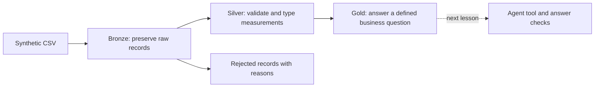

# geothermal-lakehouse-lab

Learn data engineering and agent evaluation through a small geothermal-themed project.
All wells and measurements are synthetic. This is an independent learning project;
it is not affiliated with AlterG Resources or Databricks.

## Geothermal ontology + parallel WisdomGraph memory

Start here for the graph demonstration. `ontology.json` defines a proposed taxonomy
(classes and subclasses), allowed relationships (domain/range), and validation rules.
It is not yet a domain-expert-approved model. Synthetic reservoir assignments are
explicitly invented. The design separates observations from wells, inspired by
[W3C SOSA/SSN](https://www.w3.org/TR/vocab-ssn/); the resource terminology is informed by
[DOE hydrothermal resources](https://www.energy.gov/hgeo/geothermal/hydrothermal-resources).
It is a property graph, not a complete RDF/OWL implementation.

```sh
python3 -m venv .venv
.venv/bin/python -m pip install -r requirements.txt
.venv/bin/python graph_lab.py init
docker compose up -d
# Wait until both databases finish starting, then:
.venv/bin/python graph_lab.py build
.venv/bin/python -m unittest -v
.venv/bin/python check_integration.py
open output/geothermal-graph.html
```

The offline viewer supports taxonomy/domain views, well filtering, node inspection,
and neighbor highlighting. It embeds only synthetic graph data and no credentials.
`export` regenerates it without accessing Docker; `build` writes both databases.

| Store | Browser | Bolt | Contents |
|---|---|---|---|
| Domain | http://localhost:7476 | bolt://localhost:7690 | Wells, sites, synthetic reservoirs, observations, units, provenance, quality issues, taxonomy |
| Project memory | http://localhost:7477 | bolt://localhost:7691 | WisdomGraph knowledge and an architecture decision, written using the installed library |

Browser login: user `neo4j`; password is `LAB_NEO4J_PASSWORD` in local `.env`.
Each container has its own volume. Both bind to localhost. This project does not
change `~/.wisdom`, install global agent hooks, or access existing agent memory.
`docker compose stop` stops the demo while retaining its data.

Run the queries in `demo.cypher` separately in the domain Browser. In the memory
Browser use `MATCH p=(n)-[r]->(m) RETURN p LIMIT 50`.

**Demo narrative:** inspect W001, follow its measurements to their CSV source,
compare W004's missing temperature and W005's negative flow, then show why an agent
must abstain from calling these *reservoir* temperatures. The source has no depth,
measurement location, or timestamp. Missing knowledge stays missing.

Stable IDs and a uniqueness constraint make repeated domain imports duplicate-safe.
Source hashes preserve snapshot provenance. Changed source snapshots add history;
this prototype does not yet resolve superseded observations into a current-state view.
No Delta table, Databricks workspace, live LLM, automated feedback loop, or measured
accuracy improvement is claimed. Memory entries record scope and design decisions,
not fabricated agent outcomes. Separate databases use logical ID references, not
cross-database Cypher relationships.

### Project-scoped WisdomGraph MCP

```sh
.venv/bin/python wisdom_project.py
```

This starts a stdio MCP server (it waits for a client; it is not a chat prompt).
Configure your MCP host with the absolute paths to `.venv/bin/python` and
`wisdom_project.py`. The adapter targets only the project memory container. It uses
a version-pinned internal config-path override because wisdomGraph 0.3.3 otherwise
loads global configuration. Recheck this adapter before upgrading WisdomGraph.
It is supplied and tested here; it is not automatically registered in your Codex app.
The requirements pin MCP 1.30.0: installing wisdomGraph 0.3.3 with unconstrained MCP
selected 2.3.0, which failed because `Server.list_tools` was removed. The live
integration check exercises the MCP handshake, tool listing and `wisdom_status`.

### Questions for the domain expert

- Which identifiers are authoritative across geoscience, land and finance?
- Are reservoir assignments confirmed, interpreted, or time-dependent?
- Where, when, and how were temperatures and flows measured?
- Who can approve a correction, and how should an agent retrieve it later?
- Which permissions must apply to both source data and derived graph relationships?

## Lesson 1: give the agent trustworthy data

Our question: **Which wells have temperature at least 180 C and flow at least 30 kg/s?**
These are invented classroom criteria, not evidence of commercial geothermal viability.

Run with Python 3.10 or later; no packages, account, API key, or cloud spend required:

```sh
cd /Users/chinkeonglam/claudeJob/geothermal-lakehouse-lab
python3 lesson01.py
```

The pipeline preserves six input rows, accepts four, rejects two, and returns
**W001 and W003**. Each result points back to its source CSV line.



Bronze, silver, and gold describe progressively refined data. They are a design
pattern, not three mandatory products. See the official
[Databricks medallion architecture guide](https://docs.databricks.com/aws/en/lakehouse/medallion).

This first exercise uses **SQLite to teach the transformations**. It is not a
Databricks deployment or a Delta Lake implementation. A lakehouse combines data-lake
storage with table-management and analytical capabilities; putting layer names on
SQLite tables does not make it a lakehouse. Our gold output is a query result, not
a persisted table in this lesson.

## Your first experiment

Predict the result before running:

```sh
python3 lesson01.py --min-temperature 170
```

Then inspect `data/synthetic_wells.csv` and answer:

1. Which additional well appears, and why?
2. Why is W005 excluded even though its temperature is high?
3. Why keep the rejected raw record instead of deleting it?

The SQL behind the answer is deliberately small:

```sql
SELECT well_id, site, temperature_c, flow_kg_s, source_row
FROM silver_wells
WHERE temperature_c >= 180 AND flow_kg_s >= 30
ORDER BY well_id;
```

Python loads and checks the records. SQL selects records from a table. Later, an
agent will call a bounded tool using these same explicit criteria, and our checks
will compare the agent's answer with the query result.

## What to notice in the code

- `validate()` defines a toy data-quality contract: required identifiers, finite
  numeric measurements, temperature in (0, 400], and positive flow.
- `build()` preserves original field values, records rejection reasons, and keeps
  the first valid record for each well ID. This assumes one snapshot row per well.
- `screen()` uses SQL parameters rather than interpolating user values into SQL.
- Running the script again rebuilds only the lesson tables in
  `output/lesson01.sqlite`; it never edits the source CSV.

This small batch example does not yet implement incremental ingestion, access
control, concurrent writers, deployment automation, monitoring, or an LLM.

## Next lessons

1. Reproduce the workflow using real Delta tables in Databricks.
2. Wrap the query as a tool for an agent and check answers against known results.
3. Add failure cases, repeatable evaluation, and CI.

[Databricks Free Edition](https://docs.databricks.com/aws/en/getting-started/free-edition)
offers a serverless environment with quotas. It can support platform learning;
it does not demonstrate Azure infrastructure administration. We will choose a
workspace together before creating cloud resources.
