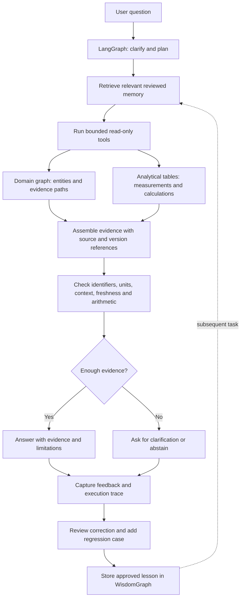
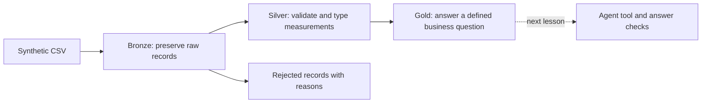

# geothermal-lakehouse-lab

A working local prototype of a geothermal knowledge graph with a separate
[WisdomGraph](https://github.com/cklam12345/wisdomGraph) agent-memory store.
The project explores how source-backed domain knowledge and reusable experience
could help agents produce answers that can be checked, explained, and corrected.

All wells and measurements are synthetic. The ontology is a proposal for review,
not a verified representation of any company's assets or processes. This is an
independent project, not affiliated with AlterG Resources or Databricks.

## What runs today

| Component | Implemented behavior |
|---|---|
| Domain ontology | 12 classes, a subclass hierarchy, allowed relationship types, and observation/provenance validation rules in `ontology.json` |
| Domain graph | 48 nodes and 111 relationships for the supplied fixture, including taxonomy and instance edges |
| Separate agent memory | WisdomGraph 0.3.3 writes two Knowledge nodes, one Experience node, and one Source node with three source links into a separate database |
| Interactive viewer | Offline HTML with domain/taxonomy views, well selection, node inspection, and neighbor highlighting |
| MCP adapter | Project-scoped WisdomGraph stdio server; handshake, tool listing, and `wisdom_status` tested |
| Validation | Four ontology contract tests plus live checks of repeat-import counts and database separation |
| Earlier SQL exercise | Local SQLite screening pipeline with explicit acceptance/rejection rules |

**Proposed next:** a LangGraph agent workflow, constrained domain-query tools, a
Databricks/Delta connection, reviewed feedback ingestion, and answer-quality
evaluation. These are architectural plans below, not implemented capabilities or
claims of measured accuracy improvement.

## How the agent and graphs would work together

The stores have different responsibilities:

- **Analytical tables:** calculate measurements, aggregates, and trends. The local
  exercise uses SQLite; a future implementation would query Delta tables through
  Databricks.
- **Domain graph:** connect wells, sites, proposed reservoir assignments,
  observations, units, and source records. It describes the subject being analyzed.
- **WisdomGraph memory:** retain relevant decisions, failures, and reviewed
  corrections across sessions. It describes experience with doing the analysis.
- **Agent orchestration:** choose tools, assemble evidence, run checks, and decide
  whether to answer, qualify a claim, or ask for missing information.

A graph connection is evidence of a modeled relationship, not proof that the
underlying assertion is true. Memory supplies context; source records and explicit
validation remain necessary to support factual answers.



This diagram is the **target workflow**. The current demo supplies the domain graph,
project-memory store, source references, and structural checks. It does not yet
execute this agent loop.

### A concrete question and execution plan

> Which wells meet our temperature and flow criteria, which share a reservoir,
> and what evidence supports the result?

1. **Clarify the contract.** Establish the temperature and flow thresholds, units,
   measurement context, time window, and meaning of “share a reservoir.” In this
   fixture, dates and measurement locations are unknown and reservoir assignments
   are synthetic. The agent must surface those limits.
2. **Retrieve applicable memory.** Consult the existing scope and measurement-context
   notes. Future reviewed lessons could identify recurring errors such as confusing
   a surface measurement with a reservoir measurement. Retrieval must filter by
   task relevance and policy/version applicability.
3. **Query numerical evidence.** A parameterized SQL tool applies the agreed
   screening policy. For the existing SQLite example, 180 C and 30 kg/s return W001
   and W003. The tool should return structured values and references, not just prose.
4. **Traverse related context.** Resolve those stable well IDs in Neo4j, retrieve
   their modeled reservoir assignments, and follow observation-to-source paths.
   In this fixture W001 and W003 have different synthetic reservoir assignments;
   that is a fixture fact, not a geological conclusion.
5. **Reconcile the evidence.** Require matching source snapshots across SQL and
   graph results. Check measurement units and scope before comparing values. A
   stale graph projection should cause a refresh request or a qualified response,
   not an unnoticed mix of old and new observations.
6. **Verify and respond.** Check numeric claims against tool results and attach
   source row/snapshot references. Explicitly state that the data cannot establish
   reservoir temperature or commercial viability. An LLM judge may assess clarity
   or evidence support; it does not replace deterministic numeric checks.
7. **Learn under review.** Preserve the trace and any correction. Add the failure to
   a regression suite, and store a reviewed lesson with its scope and provenance.
   On a later task, retrieve the lesson and test whether it changes the outcome.

**Important policy difference in the current code:** `lesson01.py` rejects a whole
row when a required measurement is invalid. The domain graph preserves individual
observations, including rejected values marked with their quality status. For
example, W004's flow remains visible even though its temperature is missing. The
future tool layer must enforce an explicit shared screening policy; visibility in
the graph alone does not make an observation eligible for an answer.

### Proposed tool contracts

These names describe future application tools; they are not currently exposed MCP
tools. The installed WisdomGraph server currently serves the separate memory store.

| Proposed tool | Responsibility | Required output |
|---|---|---|
| `screen_wells` | Execute a bounded, parameterized analytical query | Well IDs, values, units, quality policy, snapshot/version and source references |
| `trace_well_evidence` | Traverse approved domain relationships for specified IDs | Paths, source records, synthetic/assertion status and missing context |
| `retrieve_reviewed_lessons` | Select applicable WisdomGraph lessons | Lesson IDs, evidence, reviewer status, scope and supersession status |
| `verify_answer` | Check a draft's structured claims against retrieved evidence | Passed checks, failed checks and claims requiring abstention |

Raw arbitrary SQL/Cypher generation would not be the default interface. Bounded
tools let the orchestrator reason about the question while the implementation
controls permitted queries, result sizes, timeouts, and user access. Cross-store
permissions must be enforced in the application as well as the databases; copying
data into a graph does not automatically carry over source access policies.

### What would make results robust—and how to measure it

| Failure mode | Proposed control | Evaluation case |
|---|---|---|
| Wrong entity or relationship | Stable IDs; typed edges; distinguish asserted from reviewed relationships | Similar well names and an unconfirmed reservoir assignment |
| Missing or incompatible measurement context | Required units/context checks; explicit unknowns | Missing temperature, mixed units, or absent measurement depth |
| Repeated ingestion | Stable identities and duplicate-safe writes | Replay the same snapshot and compare node/edge counts; implemented live check |
| Stale graph versus updated table | Snapshot/version reconciliation and supersession rules | Correct a measurement and ensure the old value is not reported as current |
| Unsupported numerical claim | Compare structured answer claims with query results | Deliberately alter a reported number and require verification to fail |
| Repeated agent error | Retrieve reviewed, applicable corrections before acting | Repeat a failure case in a new session with and without memory |
| Incorrect or obsolete memory | Review, scope, version and withdrawal metadata | Reject a lesson that conflicts with current evidence or policy |

Compare the same held-out tasks with and without WisdomGraph memory. Hold the model,
tools, source snapshot and evaluation rubric fixed. Measure factual correctness,
source-reference accuracy, appropriate abstention, repeated-error rate, latency,
and cost. Keep corrections from evaluation tasks out of training memory when
measuring generalization; report a separate repeat-task experiment for memory reuse.
The existing tests establish structural and integration behavior only. They do not
yet establish improved agent reasoning or operational reliability.

## Repository map

| File | Purpose |
|---|---|
| `ontology.json` | Taxonomy, relationship contracts, assumptions and source references |
| `graph_lab.py` | Generate, validate, load and export the synthetic domain graph; seed project memory |
| `compose.yaml` | Two isolated Neo4j services and persistent volumes |
| `wisdom_project.py` | Scope the installed WisdomGraph MCP server to this project's memory database |
| `graph_view.html` | Standalone interactive viewer template |
| `demo.cypher` | Queries for showing taxonomy, provenance and data-quality limitations |
| `test_graph_lab.py` | Local ontology contract tests |
| `check_integration.py` | Live replay, isolation and MCP checks |
| `lesson01.py` | Earlier local SQL exercise; not a Delta implementation |

## Geothermal ontology + parallel WisdomGraph memory

Start here for the graph demonstration. `ontology.json` defines a proposed taxonomy
(classes and subclasses), allowed relationships (domain/range), and validation rules.
It is not yet a domain-expert-approved model. Synthetic reservoir assignments are
explicitly invented. The design separates observations from wells, inspired by
[W3C SOSA/SSN](https://www.w3.org/TR/vocab-ssn/); the resource terminology is informed by
[DOE hydrothermal resources](https://www.energy.gov/hgeo/geothermal/hydrothermal-resources).
It is a property graph, not a complete RDF/OWL implementation.

```sh
python3 -m venv .venv
.venv/bin/python -m pip install -r requirements.txt
.venv/bin/python graph_lab.py init
docker compose up -d
# Wait until both databases finish starting, then:
.venv/bin/python graph_lab.py build
.venv/bin/python -m unittest -v
.venv/bin/python check_integration.py
open output/geothermal-graph.html
```

The offline viewer supports taxonomy/domain views, well filtering, node inspection,
and neighbor highlighting. It embeds only synthetic graph data and no credentials.
`export` regenerates it without accessing Docker; `build` writes both databases.

| Store | Browser | Bolt | Contents |
|---|---|---|---|
| Domain | http://localhost:7476 | bolt://localhost:7690 | Wells, sites, synthetic reservoirs, observations, units, provenance, quality issues, taxonomy |
| Project memory | http://localhost:7477 | bolt://localhost:7691 | WisdomGraph knowledge and an architecture decision, written using the installed library |

Browser login: user `neo4j`; password is `LAB_NEO4J_PASSWORD` in local `.env`.
Each container has its own volume. Both bind to localhost. This project does not
change `~/.wisdom`, install global agent hooks, or access existing agent memory.
`docker compose stop` stops the demo while retaining its data.

Run the queries in `demo.cypher` separately in the domain Browser. In the memory
Browser use `MATCH p=(n)-[r]->(m) RETURN p LIMIT 50`.

**Demo narrative:** inspect W001, follow its measurements to their CSV source,
compare W004's missing temperature and W005's negative flow, then show why an agent
must abstain from calling these *reservoir* temperatures. The source has no depth,
measurement location, or timestamp. Missing knowledge stays missing.

Stable IDs and a uniqueness constraint make repeated domain imports duplicate-safe.
Source hashes preserve snapshot provenance. Changed source snapshots add history;
this prototype does not yet resolve superseded observations into a current-state view.
No Delta table, Databricks workspace, live LLM, automated feedback loop, or measured
accuracy improvement is claimed. Memory entries record scope and design decisions,
not fabricated agent outcomes. Separate databases use logical ID references, not
cross-database Cypher relationships.

### Project-scoped WisdomGraph MCP

```sh
.venv/bin/python wisdom_project.py
```

This starts a stdio MCP server (it waits for a client; it is not a chat prompt).
Configure your MCP host with the absolute paths to `.venv/bin/python` and
`wisdom_project.py`. The adapter targets only the project memory container. It uses
a version-pinned internal config-path override because wisdomGraph 0.3.3 otherwise
loads global configuration. Recheck this adapter before upgrading WisdomGraph.
It is supplied and tested here; it is not automatically registered in your Codex app.
The requirements pin MCP 1.30.0: installing wisdomGraph 0.3.3 with unconstrained MCP
selected 2.3.0, which failed because `Server.list_tools` was removed. The live
integration check exercises the MCP handshake, tool listing and `wisdom_status`.

### Questions for the domain expert

- Which identifiers are authoritative across geoscience, land and finance?
- Are reservoir assignments confirmed, interpreted, or time-dependent?
- Where, when, and how were temperatures and flows measured?
- Who can approve a correction, and how should an agent retrieve it later?
- Which permissions must apply to both source data and derived graph relationships?

## Lesson 1: give the agent trustworthy data

Our question: **Which wells have temperature at least 180 C and flow at least 30 kg/s?**
These are invented classroom criteria, not evidence of commercial geothermal viability.

Run with Python 3.10 or later; no packages, account, API key, or cloud spend required:

```sh
cd /Users/chinkeonglam/claudeJob/geothermal-lakehouse-lab
python3 lesson01.py
```

The pipeline preserves six input rows, accepts four, rejects two, and returns
**W001 and W003**. Each result points back to its source CSV line.



Bronze, silver, and gold describe progressively refined data. They are a design
pattern, not three mandatory products. See the official
[Databricks medallion architecture guide](https://docs.databricks.com/aws/en/lakehouse/medallion).

This first exercise uses **SQLite to teach the transformations**. It is not a
Databricks deployment or a Delta Lake implementation. A lakehouse combines data-lake
storage with table-management and analytical capabilities; putting layer names on
SQLite tables does not make it a lakehouse. Our gold output is a query result, not
a persisted table in this lesson.

## Your first experiment

Predict the result before running:

```sh
python3 lesson01.py --min-temperature 170
```

Then inspect `data/synthetic_wells.csv` and answer:

1. Which additional well appears, and why?
2. Why is W005 excluded even though its temperature is high?
3. Why keep the rejected raw record instead of deleting it?

The SQL behind the answer is deliberately small:

```sql
SELECT well_id, site, temperature_c, flow_kg_s, source_row
FROM silver_wells
WHERE temperature_c >= 180 AND flow_kg_s >= 30
ORDER BY well_id;
```

Python loads and checks the records. SQL selects records from a table. Later, an
agent will call a bounded tool using these same explicit criteria, and our checks
will compare the agent's answer with the query result.

## What to notice in the code

- `validate()` defines a toy data-quality contract: required identifiers, finite
  numeric measurements, temperature in (0, 400], and positive flow.
- `build()` preserves original field values, records rejection reasons, and keeps
  the first valid record for each well ID. This assumes one snapshot row per well.
- `screen()` uses SQL parameters rather than interpolating user values into SQL.
- Running the script again rebuilds only the lesson tables in
  `output/lesson01.sqlite`; it never edits the source CSV.

This small batch example does not yet implement incremental ingestion, access
control, concurrent writers, deployment automation, monitoring, or an LLM.

## Next lessons

1. Reproduce the workflow using real Delta tables in Databricks.
2. Wrap the query as a tool for an agent and check answers against known results.
3. Add failure cases, repeatable evaluation, and CI.

[Databricks Free Edition](https://docs.databricks.com/aws/en/getting-started/free-edition)
offers a serverless environment with quotas. It can support platform learning;
it does not demonstrate Azure infrastructure administration. We will choose a
workspace together before creating cloud resources.
